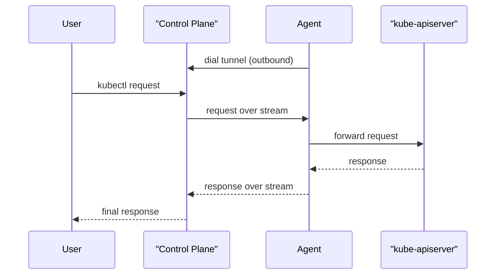

# Before / After

reference-first 변환 예제. 왼쪽(Before)은 산문 덩어리, AI 문체, 오른쪽(After)은 표, bullet, mermaid로 구조를 드러냅니다.

---

## 1. 책임 서술 문단 → Bullet

### Before

> Cluster Agent는 각 클러스터에서 하나의 인스턴스로 실행되며, Control Plane과의 outbound 연결을 유지하는 동시에 tunnel을 통해 전달받은 Kubernetes API 요청을 in-cluster API server로 전달하고, 그 응답을 다시 Control Plane으로 반환하며, 또한 resource watch 이벤트를 수집하여 Kafka로 publish하는 역할을 수행한다.

### After

Responsibilities

- Control Plane으로 outbound tunnel 유지
- tunnel 요청을 in-cluster API server로 전달
- 응답을 Control Plane으로 반환
- resource watch 이벤트를 Kafka로 publish

---

## 2. 비교 서술 문단 → Table

### Before

> 두 전송로는 성격이 다르다. gRPC tunnel은 동기 요청/응답에 쓰이며 kubectl exec나 port-forward처럼 즉시 응답이 필요한 경우에 적합하고 지연에 민감하다. 반면 Kafka는 비동기 이벤트 전달에 쓰이며 resource 변경이나 audit처럼 즉시성이 덜 중요하고 대신 backpressure를 흡수할 수 있어야 하는 경우에 적합하다.

### After

| 축 | gRPC tunnel | Kafka |
| --- | --- | --- |
| 통신 | 동기 요청/응답 | 비동기 이벤트 |
| 용도 | exec, port-forward | resource 변경, audit |
| 지연 | 민감 | 허용 |
| 보장 | 연결 유지 필요 | at-least-once |

---

## 3. 상호작용 서술 문단 → sequenceDiagram

### Before

> 먼저 Agent가 Control Plane에 outbound로 dial하여 tunnel을 수립한다. 이후 사용자가 kubectl 요청을 보내면 Control Plane이 해당 요청을 tunnel stream에 실어 Agent로 전달하고, Agent는 이를 in-cluster API server로 전달한다. API server가 응답하면 Agent가 응답을 stream으로 되돌리고, Control Plane이 사용자에게 최종 응답을 반환한다.

### After



---

## 4. AI 문체 문장 → 정리

### Before

> 이러한 아키텍처를 통해 우리는 다양한 클러스터를 손쉽게 관리할 수 있으며, 이를 통해 방화벽 설정 없이도 효율적으로 통신을 수행하는 것이 가능하다.

### After

> Agent가 outbound로만 연결하므로 cluster에 inbound 방화벽 예외가 필요 없습니다.

제거한 것: "이러한 ~를 통해", `다양한`, `손쉽게`, `이를 통해`, `효율적으로`, "수행하는 것이 가능하다".

---

## 5. 긴 대시 남발 → 문장 분리

### Before

> Agent는 outbound로만 연결한다 — inbound 방화벽이 필요 없고 — 이 점이 설치를 단순하게 만든다.

### After

> Agent는 outbound로만 연결합니다. inbound 방화벽이 필요 없어 설치가 단순합니다.

바꾼 것: em-dash 두 개를 마침표로 끊고, 삽입구를 본문에 합쳤습니다. 상세는 [style-guide.md](../style-guide.md) §8.1.

---

## 6. 부정 대구 → 직접 서술

### Before

> 이 설계의 핵심은 단순히 성능이 아니라 운영 편의성이다.

### After

> 이 설계는 무중단 배포와 롤백을 한 번의 명령으로 처리합니다.

제거한 것: `단순히 ~가 아니라 ~`(거부 대구), "핵심은"(의의 과장). 거부절을 지우고 실제로 하는 일을 적었습니다. 상세는 [style-guide.md](../style-guide.md) §8.2.

---

## 7. 의의 과장, 3개 맞춤 → 사실만

### Before

> 이 기능은 확장성, 안정성, 유연성을 제공하며, 플랫폼의 정수를 보여주는 중요한 이정표다.

### After

> 이 기능은 수평 확장과 무중단 배포를 지원합니다.

제거한 것: 억지 3개 나열("확장성, 안정성, 유연성"), 의의 과장("정수", "중요한 이정표"). 실제로 보장하는 두 가지만 남겼습니다.

---

## 8. 서술형, 질문형 헤더 → 명사형

### Before

```markdown
## 왜 캐시가 필요한가
## 이 값은 수정하면 안 된다
## 그다음에 할 일
```

### After

```markdown
## 캐시 도입 배경
## 수정 금지 설정
## 후속 작업
```

바꾼 것: 질문형("왜 ~가"), 서술형("~ 안 된다"), 지시어("그다음") 헤더를 섹션 주제를 식별하는 명사형으로. 헤더만 읽어도 구조가 잡힙니다. 상세는 [style-guide.md](../style-guide.md) §9.

---

## 9. 서술형 표 셀 → 압축

### Before

| 항목 | 설명 |
| --- | --- |
| mTLS | 별도의 설정이 필요하다 |
| 재시도 | 특정 조건에서만 사용할 수 있다 |
| 로깅 | 요청을 수신한 후 검증하고 처리한다 |

### After

| 항목 | 설명 |
| --- | --- |
| mTLS | 추가 설정 필요 |
| 재시도 | 조건부 사용 |
| 로깅 | 요청 검증, 처리 |

바꾼 것: 완결 문장(`~다`, `~한다`)을 명사형, 핵심 구로 압축했습니다. 설명이 더 필요하면 본문 문장이 맡습니다. 상세는 [style-guide.md](../style-guide.md) §4.4.
