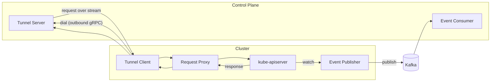

# Cluster Agent Architecture

## Overview

Cluster Agent는 각 Kubernetes 클러스터에 하나씩 실행되며, Control Plane과 outbound 연결만으로 명령을 받고 결과를 돌려줍니다. 두 전송로를 씁니다.

- gRPC reverse tunnel: 동기 요청/응답 (kubectl proxy, exec, port-forward)
- Kafka: 비동기 이벤트 (resource 변경, health, audit)

Agent는 inbound 포트를 열지 않습니다. 방화벽 안쪽에서 Control Plane으로만 dial합니다.

## Responsibilities

- Control Plane으로 outbound tunnel을 열고 유지합니다
- tunnel로 받은 Kubernetes API 요청을 in-cluster API server에 전달합니다
- 응답 stream을 Control Plane으로 되돌립니다
- resource watch 이벤트를 Kafka topic으로 publish합니다
- tunnel 끊김 시 backoff 재연결합니다

## Components

| Component | 역할 | 위치 |
| --- | --- | --- |
| Tunnel Client | gRPC bidi stream 유지, 요청 수신 | Agent (cluster 내) |
| Request Proxy | tunnel 요청 → in-cluster API server 전달 | Agent |
| Event Publisher | watch 이벤트 → Kafka producer | Agent |
| Tunnel Server | Agent 연결 accept, 요청 라우팅 | Control Plane |
| Event Consumer | Kafka topic 소비, DB 반영 | Control Plane |

## Data Flow

## Trade-offs

| 결정 | 장점 | 비용 |
| --- | --- | --- |
| Agent-initiated outbound tunnel | cluster에 inbound 포트/방화벽 예외 불필요 | Control Plane이 연결 상태를 관리해야 함 |
| gRPC bidi stream | 단일 커넥션으로 다중 요청 multiplex | stream 끊기면 진행 중 요청 전부 실패 |
| Kafka로 이벤트 분리 | 요청 경로와 독립, backpressure 흡수 | 이벤트 지연, 중복 처리(at-least-once) 필요 |

## References

- [gRPC Bidirectional Streaming](https://grpc.io/docs/what-is-grpc/core-concepts/#bidirectional-streaming-rpc)
- [Kubernetes API Concepts](https://kubernetes.io/docs/reference/using-api/api-concepts/)
- [Kafka Consumer Semantics](https://kafka.apache.org/documentation/#semantics)
