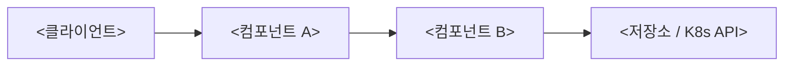

# <컴포넌트> Architecture

<!-- 채우기: H1은 문서 제목. "<컴포넌트> Architecture" 형태로. -->

## Overview

<!-- 채우기: 3~6줄 또는 표 하나. 무엇을/누가/왜 읽나. 배경, 서론 금지. -->
`<컴포넌트>`는 `<한 줄 정의>`.

| 항목 | 값 |
| --- | --- |
| 목적 | `<핵심 역할>` |
| 배포 단위 | `<Pod / Deployment / DaemonSet 등>` |
| 실행 위치 | `<Cluster / Service 측>` |
| 주요 의존 | `<Kubernetes API, gRPC, Kafka 등>` |

## Responsibilities

<!-- 채우기: 짧은 bullet. "A는 X하고 Y하며 Z한다" 금지 → 동사로 쪼갬. -->
- `<동작 1>`
- `<동작 2>`
- `<동작 3>`

## Components

<!-- 채우기: 컴포넌트 비교는 반드시 표. -->
| 컴포넌트 | 역할 | 입력 | 출력 |
| --- | --- | --- | --- |
| `<컴포넌트 A>` | `<역할>` | `<입력>` | `<출력>` |
| `<컴포넌트 B>` | `<역할>` | `<입력>` | `<출력>` |

## Data Flow

<!-- 채우기: 구조, 의존은 flowchart. 라벨에 < > 금지, 특수문자는 "..."로. -->

<!-- 채우기: 단계별 입출력이 필요하면 표로. -->
| 단계 | 입력 | 처리 | 출력 |
| --- | --- | --- | --- |
| 1 | `<입력>` | `<처리>` | `<출력>` |

## Trade-offs

<!-- 채우기: 판단, 근거만 문장/표로. -->
| 결정 | 장점 | 단점 | 대안 |
| --- | --- | --- | --- |
| `<결정>` | `<+>` | `<->` | `<대안>` |

## References

<!-- 채우기: 외부 스펙은 요약하지 말고 링크로. -->
- [<관련 문서>](<경로>)
