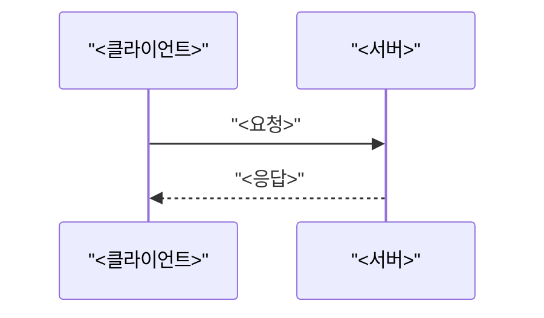
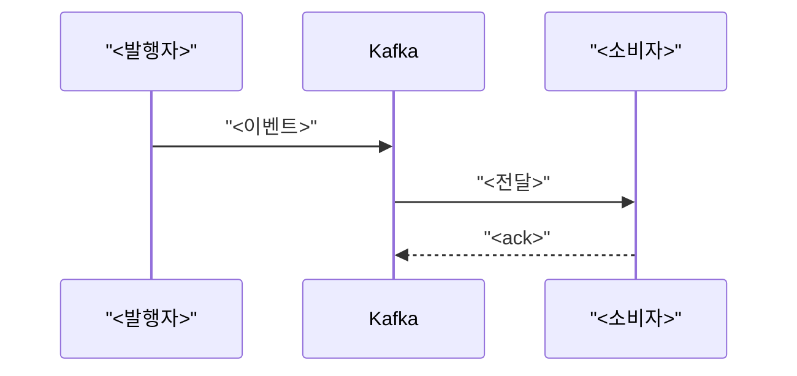

# <시스템> Communication

<!-- 채우기: H1은 통신 대상. "<A>↔<B> Communication". -->

## Overview

<!-- 채우기: 어떤 컴포넌트 사이의 통신인가. 3~6줄. -->
`<A>`와 `<B>` 사이의 통신 경로와 실패 처리를 정의합니다.

## Transports

<!-- 채우기: 전송로 비교는 반드시 표. -->
| 전송로 | 용도 | 방향 | 특성 |
| --- | --- | --- | --- |
| gRPC tunnel | `<용도>` | `<Service→Cluster 등>` | `<동기, 스트리밍>` |
| Kafka | `<용도>` | `<Cluster→Service>` | `<비동기, at-least-once>` |

## Sequence

<!-- 채우기: 상호작용마다 sequenceDiagram 하나. 라벨에 < > 금지. -->
### <상호작용 1: 예) 요청/응답>

### <상호작용 2: 예) 이벤트 발행>

## Failure handling

<!-- 채우기: 실패 유형별 처리는 표. -->
| 실패 | 감지 | 처리 | 재시도 |
| --- | --- | --- | --- |
| `<연결 끊김>` | `<감지>` | `<처리>` | `<정책>` |
| `<타임아웃>` | `<감지>` | `<처리>` | `<정책>` |

## References

- [<Communication 프로토콜 스펙>](<경로>)
