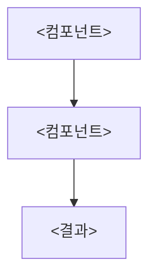
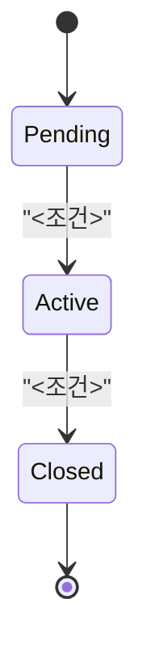

# <기능> Design

<!-- 채우기: H1은 설계 대상. "<기능> Design". -->

## Overview

<!-- 채우기: 3~6줄. 무엇을 설계하나. -->
`<기능>`을 `<방식>`으로 설계합니다.

## Context

<!-- 채우기: 왜 지금 이 설계가 필요한가. 현재 상태, 제약. 배경 나열 금지, 핵심만. -->
| 항목 | 내용 |
| --- | --- |
| 현재 상태 | `<현재>` |
| 문제 | `<문제>` |
| 제약 | `<제약 (K8s 버전, push 금지 등)>` |

## Goals / Non-Goals

| 구분 | 항목 |
| --- | --- |
| Goal | `<달성 목표 1>` |
| Goal | `<달성 목표 2>` |
| Non-Goal | `<범위 밖 1>` |
| Non-Goal | `<범위 밖 2>` |

## Design

<!-- 채우기: What → How. 개요 먼저, 그다음 diagram. -->
`<설계 개요 1~2줄>`

<!-- 채우기: 상태 전이가 있으면 stateDiagram-v2. -->

## Alternatives

<!-- 채우기: 대안 비교는 반드시 표. -->
| 대안 | 방식 | 장점 | 단점 | 채택 |
| --- | --- | --- | --- | --- |
| `<대안 A>` | `<방식>` | `<+>` | `<->` | ✅ |
| `<대안 B>` | `<방식>` | `<+>` | `<->` | ❌ |

## Risks

| 위험 | 영향 | 완화 |
| --- | --- | --- |
| `<위험>` | `<영향>` | `<완화책>` |

## References

- [<ADR / 관련 설계>](<경로>)
