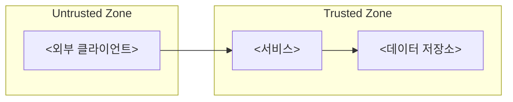

# <시스템> Security

<!-- 채우기: H1은 보안 대상. "<시스템> Security". -->

## Overview

<!-- 채우기: 무엇을 보호하나. 신뢰 모델 한 줄. 3~6줄. -->
`<시스템>`의 신뢰 경계, 인증, 위협, 완화를 정의합니다.

## Trust Boundary

<!-- 채우기: 신뢰 경계는 flowchart subgraph로. 라벨에 < > 금지. -->

## Identity / Auth

<!-- 채우기: 주체, 인증 방식은 반드시 표. -->
| 주체 | 인증 방식 | 자격 증명 | 갱신 |
| --- | --- | --- | --- |
| `<사용자>` | `<OIDC>` | `<JWT>` | `<TTL>` |
| `<Agent>` | `<mTLS>` | `<client cert>` | `<rotation>` |

## Threats & Mitigations

<!-- 채우기: 위협-완화는 반드시 표 (STRIDE 등). -->
| 위협 | 유형 | 영향 | 완화 |
| --- | --- | --- | --- |
| `<위협 1>` | `<Spoofing>` | `<영향>` | `<완화>` |
| `<위협 2>` | `<Tampering>` | `<영향>` | `<완화>` |

## Deferred / Out-of-scope

<!-- 채우기: 지금 다루지 않는 것 명시 (근거 포함). -->
| 항목 | 사유 | 후속 |
| --- | --- | --- |
| `<항목>` | `<사유>` | `<추후 계획>` |

## References

- [<위협 모델 / 보안 정책>](<경로>)
